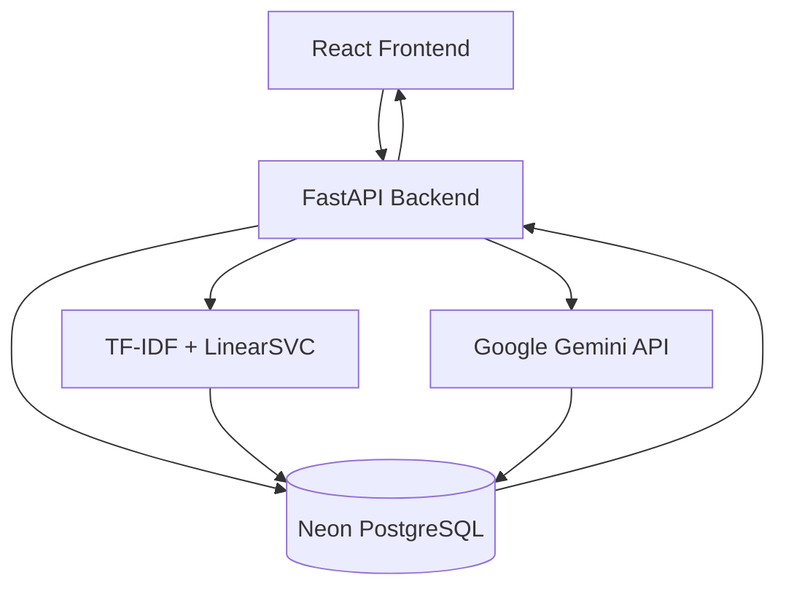

# SupportLens — AI-Powered Customer Complaint Intelligence

**An end-to-end AI application for classifying customer complaints, generating AI-powered summaries, and exploring complaint trends.**

<p align="center">
  <a href="https://support-lens-frontend.vercel.app/"><strong>🚀 Live Demo</strong></a> ·
  <a href="https://support-lens-chi.vercel.app/docs"><strong>API Documentation</strong></a>
</p>

## Overview

SupportLens is a customer complaint intelligence platform that combines machine learning, natural language processing, generative AI, and data analytics to make large volumes of customer complaints easier to understand.

The application classifies complaints into relevant financial product categories, generates concise summaries using Google Gemini, and stores analysis results in PostgreSQL for further exploration.

It is built around a dataset of 5,000 CFPB consumer complaints and supports both historical complaint analysis and new user-submitted complaints.

## Key Features

- **Automated Complaint Classification:** Predicts complaint categories using a TF-IDF and LinearSVC machine learning pipeline.
- **AI-Powered Summarization:** Uses Google Gemini to generate concise summaries of complaint narratives, with explicit user consent for external processing.
- **Interactive Analytics Dashboard:** Displays complaint volumes, category distributions, and model performance metrics.
- **Complaint Explorer:** Browse, search, and filter stored complaints and their associated analysis.
- **Live Complaint Analysis:** Submit new complaints, generate predictions and summaries, and store results in PostgreSQL.
- **REST API:** FastAPI endpoints connect the React frontend with the ML pipeline and database.

## Model Performance

The classification model was evaluated on a held-out test set.

| Metric | Result |
|---|---:|
| Accuracy | 81.9% |
| Macro F1-score | 0.7283 |
| Weighted F1-score | 0.8154 |

**Model pipeline:** TF-IDF vectorization + Linear Support Vector Classifier (LinearSVC).

## Dataset Insights

| Dataset attribute | Value |
|---|---:|
| CFPB complaints | 5,000 |
| Product categories | 11 |
| Distinct issues | 74 |

The dataset contains consumer complaint narratives across financial products such as debt collection, checking and savings accounts, credit cards, mortgages, and loans.

## Technology Stack

| Component | Technologies |
|---|---|
| Frontend | React, Vite, JavaScript |
| Backend | Python, FastAPI |
| Machine Learning | Scikit-learn, TF-IDF, LinearSVC |
| Generative AI | Google Gemini API |
| Database | PostgreSQL, SQLAlchemy |
| Data Processing | Pandas, NumPy |
| Deployment | Vercel, Neon PostgreSQL |
| Version Control | Git, GitHub |

## Architecture



## Application Workflow

1. A user submits a complaint through the React interface.
2. FastAPI receives and validates the complaint.
3. The trained ML pipeline predicts its product category.
4. Google Gemini generates a summary when the user provides consent.
5. Complaint details, predictions, and summaries are stored in PostgreSQL.
6. The frontend retrieves the stored information for analytics and exploration.

## Project Structure

```text
SupportLens/
│
├── api/
│   └── index.py
├── backend/
│   └── main.py
├── frontend/
│   └── src/
├── models/
│   └── supportlens_svm.joblib
├── notebooks/
├── src/
│   ├── predict.py
│   └── summarizer.py
├── app.py
├── database.py
├── requirements.txt
├── .python-version
└── README.md
```

## Running Locally

### 1. Clone the repository

```bash
git clone https://github.com/MANAL-12/SupportLens.git
cd SupportLens
```

### 2. Set up the Python environment

```bash
python -m venv venv
```

Activate it on Windows:

```powershell
.\venv\Scripts\Activate.ps1
```

Install dependencies:

```bash
pip install -r requirements.txt
```

### 3. Configure environment variables

Create a `.env` file in the project root:

```env
DATABASE_URL=your_postgresql_connection_string
GEMINI_API_KEY=your_gemini_api_key
FRONTEND_URL=http://localhost:5173
```

Use your own PostgreSQL connection string and Gemini API key. Never commit secrets to GitHub.

### 4. Start the backend

```bash
uvicorn backend.main:app --reload
```

Backend: `http://127.0.0.1:8000`

API documentation: `http://127.0.0.1:8000/docs`

### 5. Start the frontend

Open another terminal:

```bash
cd frontend
npm install
npm run dev
```

Frontend: `http://localhost:5173`

## Deployment

- **Frontend:** Vercel
- **Backend:** Vercel (FastAPI)
- **Database:** Neon PostgreSQL

Live application: https://support-lens-frontend.vercel.app/

## Future Improvements

- Expand the complaint dataset and evaluate generalization on newer data.
- Improve classification performance for underrepresented categories.
- Add complaint trend analysis and time-based comparisons.
- Introduce model monitoring and prediction confidence insights.

---

**Developed as an applied AI and data engineering project.**
